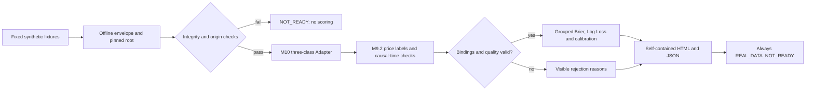

# Offline Research Demo: architecture, methods and report guide

This project investigates an important prediction-market failure mode: a model
can predict the wrong event even when both products are described as “BTC 5m.”
It makes price definitions, outcome binding, data quality and causality explicit
before allowing probability scoring. It is a research engineering demonstration,
not a trading bot or evidence of profitable prediction.

## Architecture



The old binary M10/M8 adapter is unchanged. The added offline adapter calls
M9.2's existing functions; it does not redefine TIE as DOWN or replace an
authoritative outcome with a price-derived label. OFFLINE_SYNTHETIC is distinct
from M9 PROSPECTIVE evidence. A content hash verifies consistency, not authority.

## Research method

- Price hypotheses: trade close, bid/ask midpoint and an independent reference.
  Fixed points demonstrate UP, DOWN and TIE for the same nominal window.
- Causality: source <= receipt <= availability; only inputs available at
  prediction time enter its hash; prediction precedes cycle end and outcome
  availability. A post-hoc label cannot become an earlier input.
- Probabilities: three explicit nonnegative values totaling one. The complement
  of UP includes TIE and therefore is not strict DOWN.
- Scoring: sum-of-three-squares Brier (range 0–2), true-class Log Loss, and
  classwise ECE using five fixed bins. Feed/rule/boundary groups remain separate.
- Quality: absent identity, authority, timing, price, invalid books or input
  hashes reject scoring. All rejection rows remain in the report.
- Confidence: maximum class probability only. It is neither a confidence
  interval nor measured reliability. Small calibration groups are descriptive.

The ten trade fixtures deliberately contain six UP, three DOWN and one TIE
with fixed probabilities (0.6,0.3,0.1). Brier 0.54 and ECE 0 follow by
construction. This checks metric arithmetic; it is not a model evaluation on
unseen data. One-row midpoint/reference groups cannot establish calibration.

## Run and independently reproduce

With Python 3.12 and Git, from a clean checkout:

```text
python scripts/verify_m102_reproduction.py
```

No API key, model download or third-party Python dependency is needed for this
command. It refuses tracked/untracked working-tree changes, generates twice in
separate fresh temporary directories, and compares with committed expectations
in `tests/fixtures/m102_reproduction.json`. It checks:

1. Exact SHA256 of input.json, report.json and report.html.
2. The report's semantic hash, all calibration statistics and rejection reasons.
3. Both independent runs agree and all 95 protected file hashes match.

It then writes the report and verification.json into ignored runtime output.
Temporary runs are removed. The small golden file is reviewed source control;
the verifier cannot update it or accept new hashes automatically. Verification
metadata contains the actual commit, Python version and output path, so that
metadata itself is deliberately not byte-identical across machines.

For an exploratory run during development, use `python scripts/run_m102_offline.py`.
This does not assert a clean checkout or golden-hash verification.

## Reading the HTML report

Open the printed report.html path locally; no web server is needed. On narrow
screens, scroll tables horizontally. The report includes:

- The status banner: SYNTHETIC_READY refers only to accepted synthetic records.
  REAL_DATA_NOT_READY remains visible at the same time.
- Record table: UP/DOWN/TIE, maximum probability, input age, post-hoc label,
  quality, acceptance and exact rejection codes.
- Calibration tables: group sizes, metrics and every fixed probability bin,
  including empty bins. Compare neither different targets nor tiny groups as
  evidence of skill.
- Provenance: input root and report hash for replay and consistency checking.

The demo has 12 accepted and eight rejected rows. Rejected rows do not enter
metric denominators. The report has no remote scripts/assets, wallet or account
widgets. It may be shared as a standalone synthetic research artifact.

## Continuous integration

`M10.2 Offline Reproduction` runs on pushes, pull requests and manual dispatch,
on Windows and Linux with Python 3.12. It reproduces before installing any test
dependency, then runs integration/semantics tests and index/history credential
scans. Successful runs upload the synthetic reports and verification metadata
as separate OS artifacts (14-day retention). It has read-only repository
permissions and does not reference Predict.fun credentials.

The existing `Tests` workflow remains in place for the full historical suite
and demos. A green dedicated workflow is not a substitute for that full suite.
CI does not deploy or change visibility, branches used by production, or studies.
Artifact storage follows the official
[GitHub Actions artifact mechanism](https://docs.github.com/en/actions/tutorials/store-and-share-data).

## Limitations and project boundaries

Real target compatibility remains TARGET_MISMATCH. The reviewed venue rules use
an oracle midpoint and half-tie payout; the frozen model targets Binance Spot
traded-price candle direction. There is no verified deterministic bridge.
Token/time binding, cancellation and finality still need real authoritative
evidence. Do not describe this demo as real-market validation or a trading edge.

No order execution, fills, portfolio returns, parameter optimization or new
model training is implemented by this showcase. No old sealed evidence is used.
Credentials scans are heuristics, not a proof that arbitrary inputs are safe.
Exact output hashes are tested for the declared Python/OS CI matrix; other
runtimes must pass the check instead of assuming floating-point identity.

Historical implementation and test details: [M10.2 Final Report](research/M10_2_FINAL_REPORT.md).
