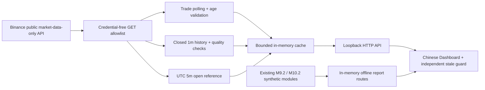

# BTC 5m Realtime Research Dashboard v1.0

这是可持续自动更新的本地应用。行情来自公开 Binance Spot BTCUSDT；研究模型保持
`REAL_DATA_NOT_READY / TARGET_MISMATCH`。界面不提供实时方向概率、账户功能或订单。

## Windows 一条命令启动

需要已安装 Python 3.12（源码兼容 3.11+）。在本分支仓库目录打开 PowerShell：

```powershell
python scripts/start_dashboard.py
```

不需要安装 requirements、Node、API Key 或设置环境变量。浏览器会自动打开
http://127.0.0.1:8765 。保持这个终端运行；Ctrl+C 停止应用。如果没有自动打开，
直接在浏览器输入该地址。如果 `python` 未加入 PATH，可以用 `py -3.12` 替换。

端口被占用时使用 `python scripts/start_dashboard.py --port 8766`；不会停止其他进程。
`--no-browser` 只关闭自动开浏览器行为。`--demo` 是明确标示的合成演示，
不会在真实网络故障时自动启用。服务固定只监听 127.0.0.1；本版本交付范围是本机浏览器。

## 页面使用

- **当前报价**：最新一次公开成交价格（USDT），并非盘口中间价或 USD 指数。
- **UTC 周期**：固定 `[start, end)` 300 秒时间桶；倒计时由本机 UTC 时钟推进。
- **周期起点参考价**：公开 Binance Spot BTCUSDT UTC 5m K 线的 `open`，
  即该时间桶的第一笔成交价。标签的参考时刻是 K 线起点，不声称是第一笔成交的精确事件时间。
  还未取到本周期数据时显示空缺，不沿用上一周期。
- **历史图**：1 小时与 24 小时切换；只显示已收盘 1m K 线的收盘价。
  鼠标移动可查看实际分钟点，缺少分钟数据时断开曲线，不插值。
- **数据健康**：源时间、接收时间、源数据年龄、请求耗时、重试与恢复记录。
- **当前选边**：页面现在把 `UP / DOWN / WAIT` 放在核心位置。`WAIT · 未评估` 表示真实市场身份、结算规则、预测和报价尚未形成可验证绑定；`WAIT · 已评估` 才表示证据完整但净优势不足。只有证据完整时才允许显示 UP 或 DOWN。
- **历史数据质量**：最近 1,440 个已收盘分钟的覆盖率和缺失数，内存缓存，不读取研究证据库。
- **离线入口**：直接打开现有 M9.2 固定合成研究、M10.2 端到端 HTML 报告。
  这些报告由原模块在内存重建，与实时行情不混合；不是实时模型输出。

主图有意展示分钟历史，而非逐笔折线；当前报价单独每约 5 秒加请求耗时更新。
页面每 2 秒查询本地缓存，多个浏览器标签不会增加上游轮询频率。

## 价格与时间语义

| 字段 | 定义 |
|---|---|
| source | Binance Spot BTCUSDT，固定公开行情域名 |
| price | `/api/v3/trades?symbol=BTCUSDT&limit=1` 的最新成交价 |
| source_at | 响应的成交 `time`，Unix 毫秒 |
| received_at | 本机成功读取响应后的 UTC 毫秒 |
| 源→接收间隔 | received_at − source_at，包含成交间隔、服务端处理与网络时间，**不等于网络 RTT** |
| request_ms | 本机单调时钟测量的整个请求耗时 |
| source_age_ms | 当前时刻至成交时间；结合单调时钟，防止时钟回拨延长有效期 |
| cycle start/end | UTC 对齐的 300 秒时间桶，不来自 Predict.fun 市场身份 |
| historical at | Binance 1m K 线收盘时间（下一分钟边界减 1ms） |

本机时钟需保持自动同步。源时间超过本机 2 秒视为时钟／数据异常，停止显示实时价；
数据超过 15 秒也撤下主价格。该阈值仅是显示健康策略，不是预测模型参数。

**本页公开成交价及 K 线开盘价，都不是 Predict.fun 的 Chainlink 结算参考价。**
不从行情推断其结算结果、不绑定冻结模型，也不将 `1-p_up` 当作严格 DOWN。
此页面不会修复已有 `TARGET_MISMATCH`。

## 健康状态与限流

| 状态 | 展示与行为 |
|---|---|
| CONNECTING | 首次等待，价格空缺 |
| HEALTHY | 验证通过且源／接收年龄都在 15 秒以内 |
| DELAYED | 过期、未来时间或乱序；主价格空缺，最后有效报价保留并注明时间 |
| DISCONNECTED | 网络错误、超时、HTTP 故障、无效响应；立即撤下实时价并重试 |
| RECOVERING | 异常后首个新鲜有效响应；下一个成功响应转正常 |

公开请求只有 GET trades / klines；不使用任何认证，拒绝 HTTP 重定向，没有任意 URL 输入。
单次 socket 超时 8 秒，响应体最多 2 MB。最新报价每次完成后等待 5 秒；
失败时等待 5/10/20/40/80/120 秒，上限 120 秒。
HTTP 418/429 至少等待 60 秒且尊重更长的 Retry-After（秒或 HTTP 日期），
同一服务中的三条数据通路共享限流暂停。多进程实例的限流状态不共享，通常只运行一个实例。

历史数据每次两页、最多各 1,000 条，每 60 秒更新，失败独立退避；只接受闭合、
时间对齐、数值有限、OHLC 合法且有成交的分钟数据。缺失保持缺失； malformed 整批拒绝，
并显示历史请求异常，旧缓存只作为历史记录。
五分钟参考价在新周期取到后缓存到本周期结束；缺失时每 5 秒起步退避。
历史和参考加载独立于报价线程，不阻塞当前行情。

前端请求本地 API 超时 4 秒；失败后 4/8/16/30 秒退避，没有重叠请求。
前端还以单调计时器独立淘汰过期主报价，即使本地服务卡住也不继续把旧值当实时值。
网络断开期间历史图仍可查看，但连接状态与最后成功时间持续可见。

## 架构



`src/btc5_v3/realtime_dashboard/` 是独立显示层；不导入生产 collector，不读取实时／sealed
数据库，不训练模型。`feed.py` 为传输与结构验证，`service.py` 管理健康和缓存，
`server.py` 提供固定路由；`static/` 是零 CDN 依赖的 HTML/CSS/JS。

本版本不持久保存真实行情；重启后重新下载公开的最近 24 小时历史。现有 M8 模型、
M9 sealed evidence 及 protected refs 保持不变。所有写入仅来自显式执行的测试／截图
工具，位于忽略的 `runtime/`；正常服务运行本身不写研究数据。

## 验收与 CI

后端测试（全部 mock/synthetic，无外部网络）：

```powershell
python -m pytest -q tests/test_realtime_dashboard.py
```

浏览器验收需要额外开发依赖（正常使用不需要）：

```powershell
python -m pip install pytest==9.1.1 playwright==1.63.0
python -m playwright install chromium
python scripts/verify_realtime_dashboard_ui.py
```

已有 Edge 时可使用 `--channel msedge`。浏览器验收覆盖刷新、1h/24h 图表、
报告链接、断连、延迟、HTTP 故障、恢复、无效响应、缺失区间与周期切换；
屏幕截图与结果写入 `runtime/dashboard-ui-tests/`，均明确标示 synthetic。
`.github/workflows/dashboard.yml` 在 Windows/Linux 自动运行这些检查、原有离线复现、
95 个受保护文件检查和 index/history 凭证扫描。CI 不访问真实行情，不使用真实 Key。
原有全量测试 CI 继续运行。

`docs/images/dashboard-live.png` 是 Windows Edge 本地运行的真实公开行情截图，
捕获于 2026-10-09 14:24:50 UTC；仅用于展示当时界面，不代表当前价格。

## 官方数据文档

- [Market Data Only URLs](https://developers.binance.com/en/docs/products/spot/faqs/market_data_only)：不需认证的公开数据域名与接口。
- [Spot market data](https://developers.binance.com/en/docs/catalog/core-trading-spot-trading/api/rest-api/market)：trades 时间、K 线 OHLC 与 UTC 时间参数。

## 局限

这是公开 BTC 行情观察应用，不是预测市场 oracle 终端。单一行情源不可达时保持明确断连，
不偷偷换价格定义、不切为模拟数据。REST 轮询不保证每笔成交都被观察；
历史图是分钟级，且公网延迟、限流、地区可达性、本机时间误差都会影响显示。
实时模型概率、结算验证和交易执行均未启用。

## 为什么当前仍可能是 WAIT

现有公开行情是 Binance Spot 成交数据。已审阅的 Predict.fun BTC 5m 规则使用
Chainlink BTC/USDT Top-of-Book 参考流；两者不是同一个随机变量。当前没有经过批准的
预测目标转换，也没有在当前市场上同时验证市场身份、UP/DOWN token mapping、实时报价、
费用和校准证据。因此页面会明确显示 `WAIT · 未评估`，并写出具体 blocker；它不会把
“BTC 正在上涨”冒充为“应该选 UP”。

选边内核保留 UP、DOWN、TIE 三分类；`1 - p_up` 只表示非 UP，不能直接变成严格 DOWN。
在明确的 HALF_TIE 合成契约中，UP 的预期兑付为 `p_up + 0.5 * p_tie`，
DOWN 为 `p_down + 0.5 * p_tie`；减去该侧 ask 和显式 fee/slippage 才是研究净优势。
STRICT 合成契约中的 tie 兑付为零，不能用来代表未经核验的真实市场规则。
缺少证据时不计算净优势。证据完整后，价差、深度、剩余时间或净优势门槛不通过，
才产生 `WAIT / EVALUATED`。这里的费用和滑点仍是显式研究输入，不是成交保证。

目前该计算内核只支持合成或 mock 验证。输入自身声明的 approval digest 不构成
真实预测批准，所有 `REAL_VERIFIED` 输入仍被拒绝，直到独立的真实预测验证机制完成。
Dashboard 尚未接入真实选边内核；未绑定市场时没有选边有效期，不使用 Binance 时钟代填。
合成测试通过不构成真实市场可用性。
